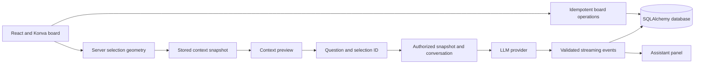

# Smart Selection and contextual LLM vertical slice

The implementation follows SRS AIB-SRS-001 sections 3.1–3.5, 7.4–7.8, 13.4, 14.5–14.6 and 21. The user-requested stack change replaces Spring Boot with Python. Board, selection and orchestration modules are kept separate within one FastAPI service to make the first journey runnable with two local processes.

## Request path



The frontend never sends authoritative extracted text to the AI endpoint. It sends an owned board ID, a selection ID, a question and a supported intent. The server resolves the snapshot and scoped history. Board text is serialized as untrusted data, separate from the versioned tutor instructions. No web, retrieval or arbitrary tool execution is enabled.

## SRS coverage

| Requirement | Implementation |
| --- | --- |
| AIB-401–404 object, rectangle, lasso and extraction | Server geometry, including polygon edge crossings and concave regions; Konva selection tools |
| AIB-405 nearby context | Nearest heading above each selected object, within 180 board units and horizontally overlapping; context distinguished from explicit selection |
| AIB-406 context preview | Ordered text/equations, selected IDs, nearby headings, recognition state and snapshot version |
| AIB-407 recognition-required content | Transcription-required state for strokes/unlabeled shapes; corrected object must be saved and reselected |
| AIB-501–505 orchestration and prompting | Python provider interface, versioned tutor prompt, three explicit supported intents; no speculative tool routing |
| AIB-506 streaming | SSE `request_started`, `answer_delta`, `sources`, `completed` and `error`; disconnect/cancellation handling |
| AIB-508 usage | Provider, configured model, prompt version, actual tokens, first-token latency, duration and optionally priced cost |
| AIB-509 response validation | Typed provider events, bounded text output, explicit completed event required; failures and partial output never reported as complete |
| Board foundation | Owner-scoped boards, transactional operation batches, idempotency keys, version conflicts, current snapshots and persisted chat |

## API

All endpoints are under `/api/v1`. Successful responses use `{data, meta: {requestId}}`; errors use `{error: {code, message, requestId, details}}`. Streaming responses use SSE. `X-Request-ID` is returned on responses. UUIDs identify boards, objects, selections, operations and AI requests.

| Method | Path | Purpose |
| --- | --- | --- |
| GET | `/health` | Service and provider mode |
| GET | `/boards` | List up to 100 owned boards, newest first |
| POST | `/boards` | Create a board; UUID `Idempotency-Key` header required |
| GET | `/boards/{id}` | Restore objects, latest selection and interactions |
| POST | `/boards/{id}/operations` | Atomic create/update/delete operations with `baseVersion` |
| POST | `/boards/{id}/selection` | Validate geometry and persist extracted context |
| POST | `/ai/ask/stream` | Stream an answer using an owned selection snapshot |

```json
{
  "selectionType": "RECTANGLE",
  "bounds": {"x": 100, "y": 200, "width": 300, "height": 150},
  "includeSurroundingContext": true
}
```

```json
{
  "boardId": "<board UUID>",
  "selectionId": "<selection UUID>",
  "question": "Explain this in simple language.",
  "intent": "EXPLAIN"
}
```

Supported intents are `EXPLAIN`, `SUMMARIZE` and `GENERATE_EXAMPLES`. Follow-ups reuse the same `selectionId`. The last six completed turns are sent, with no cross-selection history. Failed/cancelled answers remain visible as partial interactions but are excluded from the model's conversation history.

Defaults bound boards to 500 objects, selections to 100 objects including headings, context to 12,000 characters, question length to 2,000 characters, and response text to 24,000 characters. Requests are limited to 2 MB. One active AI request per actor and 20 AI requests per minute are enforced locally. Rotation is intentionally zero in this slice so geometric extraction matches displayed objects.

Operation receipts include a payload hash. Replaying an identical operation is safe; reusing an operation ID for different content fails. The board version is advanced with a database compare-and-swap inside the same transaction as operation receipts. A stale write fails instead of overwriting another session's edits. The frontend retains pending operation IDs across retries during the current page session.

## Validation and limits

The automated suite checks the first SRS journey through the real FastAPI routes with temporary durable SQLite databases. It also exercises selection geometry, excluded context, authorization, save conflict behavior, provider output failures and cancellation. The frontend production build checks TypeScript and bundles the Konva client component separately from server rendering.

Verified in this workspace: 36 Python tests, 7 frontend data/stream-parser/native-transport tests and the production frontend build pass. The original isolated process-level smoke check passed through the production Next.js proxy, including progressive SSE delivery, idempotent retries, context exclusion, disconnect cancellation and board/interaction restoration after restarting the Python API. Browser surfaces were unavailable in this session, so visual layout and pointer interactions have not been verified in a browser. See the Android hosting guide for the APK build and hosted connection setup.

Live OpenAI credentials, model answer quality, PostgreSQL, OIDC provider integration, production load and browser compatibility need environment-specific validation. Prompt separation is a defense, not a claim of complete prompt-injection resistance. Educational safety and answer quality require model evaluation before a student-facing release.

This is a development vertical slice, not the entire production MVP. Deferred work includes browser OIDC login, role/classroom management, schema migrations, historical board versions and restore UI, distributed quotas, offline IndexedDB drafts, OCR, true mathematical typesetting/solver integration, PDF/image exports, RAG, web search, source citations, moderation, collaboration, cloud deployment and production monitoring. The JSON export is the only export format implemented here.
